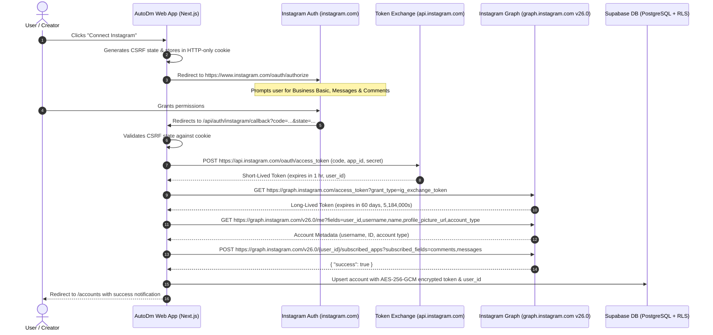

# AutoDm Platform Architecture & Meta API Specification

**System:** AutoDm Multi-Tenant Instagram Comment-to-DM Automation SaaS
**Authentication Standard:** Instagram Login for Business (`graph.instagram.com`)
**Default Graph API Version:** `v26.0` (Configurable via `META_GRAPH_API_VERSION`)
**Status:** Architecture Report Corrected & Verified

---

## 1. Executive Architecture Summary

AutoDm is a **multi-tenant, public SaaS platform** (modeled after InstantDM) that allows creators, businesses, and agency operators to connect their Instagram Professional (Business / Creator) accounts, select their published Posts or Reels, and configure automated keyword-triggered Direct Messages (Private Replies) with sub-second response times.

### Key Architectural Pillars
1. **Pure Instagram Login for Business:** Authentication and permissions operate directly through Instagram's native OAuth endpoints on `api.instagram.com` and `graph.instagram.com`. The platform **does not** use Facebook Login for Business and **does not** require users to link a Facebook Page or assign Page permissions.
2. **Strict Minimal Scopes:** Requests only the 3 permissions required for automation:
   - `instagram_business_basic`
   - `instagram_business_manage_messages`
   - `instagram_business_manage_comments`
   (Zero Facebook Page permissions requested).
3. **Graph API Version:** Standardized to **v26.0** across all outbound requests, with environment variable override (`META_GRAPH_API_VERSION`).
4. **Two-Tier Webhook Delivery:**
   - *Tier 1 (Application-Level):* Webhook endpoint and verify token configured in the Meta Developer Dashboard for the `instagram` object (`comments`, `messages`).
   - *Tier 2 (Per-Account Subscription):* Mandatory programmatic registration of each connected tenant account via `POST https://graph.instagram.com/v26.0/{user_id}/subscribed_apps`.
5. **Multi-Tenant SaaS Data Isolation:** User accounts, connected Instagram profiles, automation rules, and dispatch audit trails are stored in PostgreSQL (Supabase) enforced by Row Level Security (`auth.uid() = user_id`) and AES-256-GCM encrypted token storage.

---

## 2. Authentication Flow: Pure Instagram Login for Business



### Detailed Endpoint Specifications

| Step | Endpoint | Method | Key Parameters / Headers | Purpose |
|---|---|---|---|---|
| **1. Authorization** | `https://www.instagram.com/oauth/authorize` | GET | `client_id`, `redirect_uri`, `response_type=code`, `scope`, `state`, `enable_fb_login=0`, `force_authentication=1` | Redirects creator to Instagram consent screen |
| **2. Short-Lived Token Exchange** | `https://api.instagram.com/oauth/access_token` | POST | `client_id`, `client_secret`, `grant_type=authorization_code`, `redirect_uri`, `code` (Form-URL-Encoded) | Exchanges authorization code for 1-hour short-lived token |
| **3. Long-Lived Token Upgrade** | `https://graph.instagram.com/access_token` | GET | `grant_type=ig_exchange_token`, `client_secret`, `access_token` | Exchanges short-lived token for 60-day long-lived token |
| **4. Token Refresh** | `https://graph.instagram.com/refresh_access_token` | GET | `grant_type=ig_refresh_token`, `access_token` | Extends 60-day long-lived token before expiry (available when token is at least 24 hours old) |
| **5. User Profile Retrieval** | `https://graph.instagram.com/v26.0/me` | GET | `fields=user_id,username,name,profile_picture_url,account_type`, `access_token` | Obtains Instagram business profile and verifies account eligibility |
| **6. Media Library Retrieval** | `https://graph.instagram.com/v26.0/{user_id}/media` | GET | `fields=id,caption,media_type,media_url,thumbnail_url,permalink,timestamp`, `limit=20`, `access_token` | Populates visual post and Reel selector in automation builder |

---

## 3. Required Permissions

The integration requires **strictly 3 Instagram Business scopes**:

1. **`instagram_business_basic`**:
   - Accesses basic business profile metadata (account ID, username, name, profile picture).
   - Retrieves published media (Posts, Reels, Carousel albums) for automation attachment.
2. **`instagram_business_manage_messages`**:
   - Dispatches Private Replies (`POST /{user_id}/messages` with `recipient.comment_id`).
   - Receives inbound direct message and story reply webhook events.
3. **`instagram_business_manage_comments`**:
   - Receives inbound comment webhook events on Posts and Reels.
   - Posts public comment replies (`POST /{comment_id}/replies`) for engagement loops.

> [!IMPORTANT]
> **No Facebook Page Permissions Required:**
> Permissions such as `pages_show_list`, `pages_read_engagement`, `pages_manage_metadata`, and `business_management` are **not requested**. They belong to Facebook Login for Business and are completely omitted.

---

## 4. Webhook Subscription Architecture

Receiving Instagram events requires a **two-tier configuration**:

### Tier 1: Application-Level Webhook Configuration
- Configured once in the **Meta Developer Dashboard**:
  - **Product:** Instagram ➔ Webhooks (or App Dashboard ➔ Webhooks ➔ Object: `instagram`).
  - **Callback URL:** `https://<domain>/api/webhooks/instagram`
  - **Verify Token:** Matching `process.env.META_VERIFY_TOKEN`.
  - **Subscribed Fields:** `comments`, `messages`.
- Handshake endpoint:
  ```http
  GET /api/webhooks/instagram?hub.mode=subscribe&hub.challenge=1158201444&hub.verify_token=<token>
  ```
  Returns `200 OK` with raw `hub.challenge` string.
- Inbound event verification:
  All incoming `POST` requests verify the timing-safe `X-Hub-Signature-256` HMAC-SHA256 signature calculated over the raw request buffer using `META_APP_SECRET`.

### Tier 2: Per-Account Webhook Subscription
Even when the application-level webhook is active, Meta will **not deliver** events for an individual Instagram account until that specific account subscribes the app.

- **Subscribe Account:**
  ```http
  POST https://graph.instagram.com/v26.0/{user_id}/subscribed_apps?subscribed_fields=comments,messages&access_token={long_lived_token}
  ```
  Response: `{ "success": true }`
- **Query Active Subscriptions:**
  ```http
  GET https://graph.instagram.com/v26.0/{user_id}/subscribed_apps?access_token={long_lived_token}
  ```
  Response: `{ "data": [{ "subscribed_fields": ["comments", "messages"] }] }`
- **Unsubscribe Account (on disconnect):**
  ```http
  DELETE https://graph.instagram.com/v26.0/{user_id}/subscribed_apps?access_token={long_lived_token}
  ```
  Response: `{ "success": true }`

AutoDm automatically executes this call during the OAuth callback immediately after obtaining the 60-day token.

---

## 5. Event Processing & Idempotent Private Reply Dispatch

### Inbound Comment Payload Structure
```json
{
  "object": "instagram",
  "entry": [
    {
      "id": "178414055219901",
      "time": 1728864000,
      "changes": [
        {
          "field": "comments",
          "value": {
            "id": "18042918239012345",
            "text": "Please send me the link!",
            "from": {
              "id": "17841499999999999",
              "username": "creator_follower"
            },
            "media": {
              "id": "17998822334455667"
            }
          }
        }
      ]
    }
  ]
}
```

### Outbound Private Reply Dispatch
- **Endpoint:** `POST https://graph.instagram.com/v26.0/{instagram_user_id}/messages`
- **Headers:** `Authorization: Bearer {long_lived_access_token}`, `Content-Type: application/json`
- **Payload:**
  ```json
  {
    "recipient": {
      "comment_id": "18042918239012345"
    },
    "message": {
      "text": "Hey @creator_follower! Here is the guide you asked for: https://autodm.app/guide"
    }
  }
  ```

### Rules & Rate Limits:
1. **7-Day Window:** Private replies must be sent within 7 days of the comment creation timestamp.
2. **Single Reply Enforcement:** Exactly one private reply is allowed per `comment_id`. Meta rejects duplicate attempts with subcode `2534063`. AutoDm enforces this via PostgreSQL unique constraint on `comment_id`.
3. **Idempotency Flow:** Atomic database claim (`INSERT ... ON CONFLICT DO NOTHING`) before API call. Record status transitions from `pending` to `delivered` (storing `message_id`) or `failed` (storing diagnostic error code).

---

## 6. Multi-Tenant SaaS Architecture & Tenant Isolation

```
┌────────────────────────────────────────────────────────┐
│                   Next.js 15 Web App                   │
│   /login   /signup   /accounts   /automations   /activity│
└───────────┬────────────────────────────────┬───────────┘
            │                                │
            ▼                                ▼
┌────────────────────────┐      ┌────────────────────────┐
│  Supabase Auth (Users) │      │  REST & Webhook Routes │
│  - Email / Password    │      │  - /api/auth/instagram │
│  - JWT (auth.uid())    │      │  - /api/webhooks/insta │
└───────────┬────────────┘      │  - /api/automations    │
            │                   │  - /api/media          │
            ▼                   └───────────┬────────────┘
┌───────────────────────────────────────────▼────────────┐
│              Supabase PostgreSQL Database              │
│                                                        │
│  - connected_accounts (user_id FK, encrypted tokens)   │
│  - automation_rules   (user_id FK, post_id, keywords)  │
│  - comment_dispatches (user_id FK, unique comment_id)  │
│                                                        │
│  Row Level Security (RLS):                             │
│  CREATE POLICY tenant_isolation ON <table_name>        │
│  FOR ALL USING (auth.uid() = user_id);                 │
└────────────────────────────────────────────────────────┘
```

### Tenant Security Principles:
1. **User Separation:** Every connected account, automation rule, and activity log references `user_id UUID REFERENCES auth.users(id)`.
2. **Row Level Security:** RLS policies prevent users from viewing or modifying other users' Instagram accounts or rules.
3. **Token Encryption:** Tokens are encrypted using AES-256-GCM with authenticated tags (`iv:authTag:ciphertext`). Tokens are never sent to the browser or logged in plain text.
4. **Environment Fallback (Demo Mode):** If Supabase or live Meta credentials are not configured, the app seamlessly runs in safe local Demo Mode using client fixtures and in-memory simulated dispatches.

---

## 7. Status & Testing Matrix

| Component / Step | Implementation Status | Automated Test Status | Live Meta Verification Status |
|---|---|---|---|
| **OAuth URL Generator** | Complete (`src/lib/meta.ts`) | Passed (`instagram-oauth.test.mjs`) | Verified URL format & query params |
| **CSRF State Generation & Validation** | Complete (`/api/auth/instagram`) | Passed (`instagram-oauth.test.mjs`) | Verified with secure HTTP-only cookies |
| **Short-Lived Token Exchange Client** | Complete (`exchangeInstagramCode`) | Unit tested | Requires live user authorization code |
| **Long-Lived Token Exchange Client** | Complete (`getLongLivedInstagramToken`) | Unit tested | Requires valid short-lived token |
| **Token Refresh Client** | Complete (`refreshLongLivedInstagramToken`) | Unit tested | Requires token ≥ 24h old |
| **User Profile Retrieval** | Complete (`getInstagramUserProfile`) | Unit tested | Requires active token |
| **Media Library Retrieval** | Complete (`getInstagramMedia`) | Unit tested | Requires active token |
| **Per-Account Webhook Registration** | Complete (`subscribeAccountWebhooks`) | Passed (`instagram-oauth.test.mjs`) | Requires active token & Meta App approval |
| **App-Level Webhook Handshake (GET)** | Complete (`/api/webhooks/instagram`) | Handshake verified | Ready for Meta Dashboard subscription |
| **HMAC-SHA256 Signature Validation** | Complete (`crypto.ts`) | Passed (`webhook-signature.test.mjs`) | Validated with real HMAC buffers |
| **Deduplication Ledger (Idempotency)** | Complete (`ledger.js`) | Passed (`idempotency.test.mjs`) | Validated with SQLite & PostgreSQL schemas |
| **Keyword Matcher Engine** | Complete (`matcher.ts`) | Passed (`matcher.test.mjs`) | Validated for contains, exact, case-insensitive |
| **Next.js Production Build** | Complete (20 routes) | Built in 4.9s | Zero errors, zero warnings |
