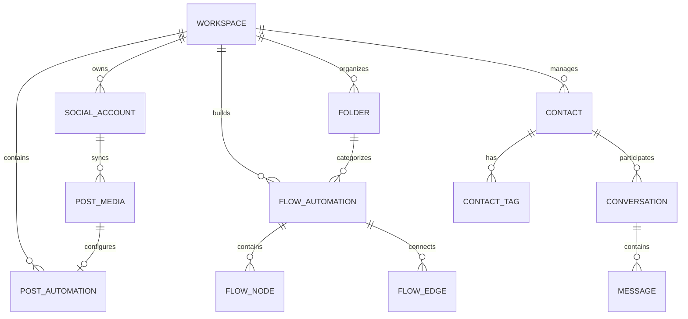

# Data Model & State Specifications

**Target:** InstantDM (`app.instantdm.com`)
**Methodology:** Inferred from REST payload structures, bundle schemas, and component prop types.

---

## 1. Entity-Relationship Diagram



---

## 2. Inferred TypeScript Domain Schemas

### 2.1. Social Account Entity
*Confidence: Verified (Observed in Meta OAuth parameters and active profile)*

```typescript
export interface SocialAccount {
  id: string;                      // Internal UUID
  workspaceId: string;
  platform: 'instagram' | 'facebook';
  platformAccountId: string;       // Meta Page ID / IG Business Account ID
  username: string;                // e.g. "automation.normie"
  name?: string;
  profilePictureUrl?: string;
  accessToken: string;             // Encrypted long-lived page token
  tokenExpiresAt: string;          // ISO Date
  status: 'active' | 'disconnected' | 'expired';
  followersCount?: number;
  connectedAt: string;
}
```

### 2.2. Post Automation Entity (`/manage-post/:id`)
*Confidence: Verified (Observed in live simulator and REA viewport)*

```typescript
export interface PostAutomation {
  id: string;
  workspaceId: string;
  socialAccountId: string;
  postId: string;                  // Instagram Media ID (e.g. "18116468645326656")
  postPermalink: string;
  postThumbnailUrl: string;
  postType: 'posts' | 'reels' | 'stories' | 'live' | 'collabs';
  status: 'active' | 'inactive';

  // Trigger Configuration
  trigger: {
    matchType: 'specific' | 'all';
    keywords: string[];            // e.g. ["link", "ebook", "price"]
    excludeKeywords?: string[];
  };

  // Public Comment Auto-Reply
  commentReply: {
    enabled: boolean;
    replies: string[];             // e.g. ["Thanks! Check DM ❤️", "Sent ✅", "Check DM 📸"]
    useAiCommentReply: boolean;    // Contextual AI spam prevention
    nonFollowerReply?: {
      enabled: boolean;
      replies: string[];
    };
  };

  // Private DM Payload
  directMessage: {
    text: string;                  // e.g. "Hey {{username}}! Here is your download link:"
    buttons?: Array<{
      type: 'url' | 'flow';
      label: string;               // e.g. "Open Link"
      url?: string;
      targetFlowId?: string;
    }>;
    trackClicks: boolean;
  };

  // Follower-Gated Content
  followerGate: {
    enabled: boolean;
    teaserMessage?: string;
    followCheckButtonText?: string; // "Started following you! 👍"
  };

  metrics: {
    commentsProcessed: number;
    dmsSent: number;
    linkClicks: number;
  };
  updatedAt: string;
}
```

### 2.3. Visual Flow Entity (`/flow-v2/editor`)
*Confidence: Verified (Observed in flow canvas and extracted chunks)*

```typescript
export interface FlowAutomation {
  id: string;
  workspaceId: string;
  folderId?: string;
  name: string;                    // e.g. "Hair products comment flow"
  status: 'draft' | 'live';
  nodes: FlowNode[];
  edges: FlowEdge[];
  createdAt: string;
  updatedAt: string;
}

export type FlowNodeType =
  | 'trigger'
  | 'send_message'
  | 'ai_agent'
  | 'condition'
  | 'delay'
  | 'collect_email'
  | 'custom_field'
  | 'tag'
  | 'webhook'
  | 'send_file';

export interface FlowNode {
  id: string;                      // e.g. "node_trigger_1"
  type: FlowNodeType;
  position: { x: number; y: number };
  data: {
    title: string;
    configured: boolean;
    // Specific parameters based on type:
    triggerConfig?: {
      dmReply?: { enabled: boolean; keywords: string[] };
      storyReply?: { enabled: boolean; keywords: string[] };
      commentReply?: { enabled: boolean; keywords: string[] };
    };
    messageConfig?: {
      messages: Array<{
        type: 'text' | 'button' | 'image' | 'audio' | 'file';
        text?: string;
        mediaUrl?: string;
        buttons?: Array<{ label: string; url?: string; targetPortId: string }>;
      }>;
      trackClicks: boolean;
    };
    delaySeconds?: number;
    conditionRules?: Array<{ field: string; operator: string; value: string }>;
    tagAction?: { operation: 'add' | 'remove'; tagName: string };
    webhookUrl?: string;
  };
}

export interface FlowEdge {
  id: string;                      // e.g. "edge_1_2"
  source: string;                  // Source Node ID
  sourceHandle: string;            // Output port name (e.g. "then", "button_1")
  target: string;                  // Target Node ID
  targetHandle: string;            // Input port name (e.g. "input")
}
```

### 2.4. Contact & Audience CRM Entity (`/contacts-v2`)
*Confidence: Verified (Observed in table columns and filter props)*

```typescript
export interface Contact {
  id: string;
  workspaceId: string;
  platform: 'instagram' | 'facebook';
  platformUserId: string;          // IGSID (Instagram Scoped User ID)
  username: string;                // e.g. "kkartik.sonii"
  name?: string;
  avatarUrl?: string;
  email?: string;
  phone?: string;
  tags: string[];                  // e.g. ["VIP", "Lead", "Purchased"]
  customFields: Record<string, any>;
  humanTakeover: boolean;          // true = automated responses paused
  takeoverExpiresAt?: string;
  lastInteractionAt: string;
  createdAt: string;
}
```

### 2.5. Messenger Thread & Message Entity (`/messenger`)
*Confidence: Verified (Observed in two-pane message view)*

```typescript
export interface ConversationThread {
  id: string;
  workspaceId: string;
  contactId: string;
  platform: 'instagram' | 'facebook';
  unreadCount: number;
  lastMessageSnippet: string;
  lastMessageTimestamp: string;
  isArchived: boolean;
}

export interface DirectMessage {
  id: string;
  threadId: string;
  senderType: 'contact' | 'bot' | 'human_agent';
  text: string;
  mediaUrl?: string;
  status: 'sent' | 'delivered' | 'read' | 'failed';
  timestamp: string;
}
```

### 2.6. Insights & Metrics Entity (`/dashboard`)
*Confidence: Verified (Observed in Insights cards)*

```typescript
export interface InsightsMetrics {
  period: '7D' | '14D' | '30D';
  dmsSent: number;
  linkClicks: number;
  clickThroughRate: number;        // (linkClicks / dmsSent) * 100
  activeConversations: number;
  aiRepliesCount: number;
  creditsRemaining: number;
  subscriptionPlan: 'free' | 'pro' | 'trendsetter';
  renewalDate: string;
}
```
