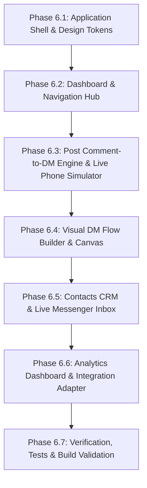

# Independent Implementation Plan & Architecture Blueprint

**Project Name:** `HyperDM` (Independent Clean-Room Instagram & Meta Automation Platform)
**Target Inspiration:** InstantDM (`app.instantdm.com`)
**Core Directive:** 100% original code, independent branding, maintainable modern architecture, and zero proprietary asset infringement.

---

## 1. Architectural Strategy & Technology Stack

To ensure superior performance, maintainability, and clean code boundaries, we adopt:

| Layer | Chosen Technology | Rationale |
|---|---|---|
| **Build Tool & Bundler** | **Vite** | Ultra-fast HMR, lightweight production builds, native ESM. |
| **Frontend Framework** | **React 19 + TypeScript** | Strict type safety for complex node graphs and automation schemas. |
| **Styling & Design System** | **Tailwind CSS + CSS Variables** | Faithful reproduction of the measured `#6366f1` Indigo / Slate tokens with high styling flexibility. |
| **Iconography** | **Lucide React** | Clean, modern, highly consistent outline iconography. |
| **Flow Builder Canvas** | **@xyflow/react (ReactFlow)** | Industry-standard, accessible graph engine supporting custom handles, nodes, and drag-and-drop connections. |
| **State Management** | **Zustand + LocalStorage Sync** | Lightweight reactive store with zero boilerplate, supporting undo/redo and draft auto-saving. |
| **API & Integration Layer** | **Adapter Pattern** (`MetaApiAdapter`) | Clear separation between mock demo mode and production Meta Graph API calls. |

---

## 2. Independent Brand Identity: "HyperDM"

- **Name:** **HyperDM** (Tagline: *Next-Gen Instagram & Messenger Automation*)
- **Brand Colors:**
  - Primary Accent: Indigo `#6366f1` / Deep Violet `#4f46e5`
  - Accent Gradient: `linear-gradient(135deg, #6366f1 0%, #a855f7 50%, #ec4899 100%)`
  - Dark Mode & Surface Backgrounds: `#0f172a` (Slate 900) or Clean Light `#f8fafc` (Slate 50)
- **Original Assets:** Handcrafted SVG logos, original vector phone simulator frames, and custom badges.

---

## 3. Prioritized Implementation Phases

### Phase 6.1 — Project Foundation, Application Shell & Design System
1. Initialize Vite + React + TypeScript project in workspace `c:\Users\Ved\Documents\insta-auto`.
2. Configure Tailwind CSS with the extracted design tokens (`#6366f1`, `#10b981`, `#f8fafc`, `#1e293b`).
3. Build the global layout shell:
   - Left vertical navigation dock (`LeftNav`) with all routes.
   - Top account bar with connected account indicator.
   - Right collapsible features & tutorials drawer (`RightSidebar`).
   - React Router v6 route configuration matching the inventory.

### Phase 6.2 — Dashboard & Social Account Connection
1. Implement the Main Dashboard (`/`):
   - Pro trial credit counter (e.g. 500 credits remaining).
   - Quick action category cards (Instagram Automation, Facebook Automation, Post Scheduler).
   - AI automation builder prompt bar.
2. Build the Social Account Connection modal with simulated / live Meta OAuth handshake.

### Phase 6.3 — Instagram Automations Hub & Interactive Phone Simulator (`/ig`, `/manage-post/:id`)
1. Implement the Instagram Automations Grid (`/ig`):
   - Sub-filters: `Comments / Replies`, `DM Automation`.
   - Category pills: `Posts`, `Collabs`, `Stories`, `Live`.
   - 9:16 Reels thumbnail grid with status pills (`⚡ Automated`, `⊗ Not Automated`).
2. Build the Post Automation Editor (`/manage-post/:id`):
   - **Interactive iPhone Simulator:** Realistic frame, Comment vs DM tabs, real-time typing animation for comments and bot replies.
   - **Trigger Card:** Specific keywords (chip input) vs All comments.
   - **Public Comment Replies Card:** Dynamic chip list with multiple randomized replies.
   - **Private DM Payload:** Rich textarea with variable interpolation (`{{username}}`).
   - **Follower-Gated Content Card:** Toggle with preview card ("Follow to Unlock").
   - Draft and Publish persistence.

### Phase 6.4 — Visual DM Flow Builder (`/flow-v2`, `/flow-v2/editor`)
1. Implement Flow List (`/flow-v2`):
   - Left folder hierarchy with `+ New Folder`.
   - Search, trigger filters, status toggles.
   - Multi-select actions (duplicate, export, delete).
2. Implement Visual Canvas (`/flow-v2/editor`):
   - ReactFlow canvas with dotted grid background and pan/zoom dock.
   - Custom Node Cards:
     - `Trigger Node` (DM, Story, Comment toggles)
     - `Send Message Node` (Text, Buttons, Image, Audio, File)
     - `AI Agent Node` (Prompt & Knowledge Base)
     - `Condition / Branch Node`
     - `Delay Node` (Typing indicator simulation)
     - `Tag & Custom Field Nodes`
     - `Webhook Node`
   - Smooth curved bezier connector lines.
   - Floating Bottom Toolbelt Dock.
   - Contextual Right-Hand Configuration Drawers.

### Phase 6.5 — Contacts CRM & Live Messenger Inbox (`/contacts-v2`, `/messenger`)
1. Implement Contacts CRM (`/contacts-v2`):
   - Instagram / Facebook platform toggle.
   - Search and tag filtering.
   - Table columns: Contact avatar, tags, custom fields, **Human Takeover toggle switch**, date added.
   - CSV export functionality.
2. Implement Live Messenger (`/messenger`):
   - Two-pane layout with folder selector.
   - Conversation threads list with relative timestamps.
   - Active message conversation feed and message composer.

### Phase 6.6 — Analytics Hub & Integration Boundaries (`/dashboard`, `/api-integration`)
1. Implement Performance Dashboard (`/dashboard`):
   - 7D / 14D / 30D date range selector.
   - Metric cards: DMs Sent, Link Clicks, CTR, Active Conversations, AI Replies.
2. Implement Meta API Adapter layer:
   - `MockMetaAdapter`: Generates realistic Instagram posts, comments, and conversation events for offline development.
   - `LiveMetaAdapter`: Plug-and-play boundary for production Meta Graph API calls.

### Phase 6.7 — Validation, Build & Polish
1. Validate responsive layouts (Desktop, Tablet, Mobile).
2. Test keyboard navigation and `prefers-reduced-motion` compliance.
3. Run TypeScript type checks and production bundle build (`npm run build`).
