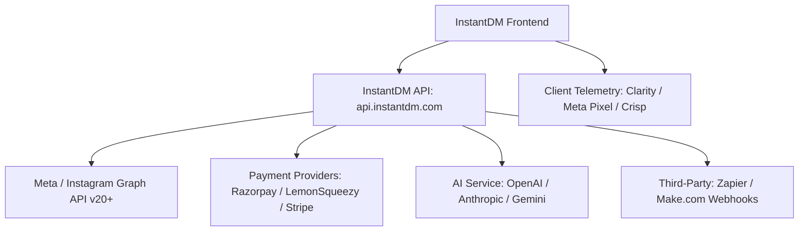

# Integration Map & External Boundaries

**Target:** InstantDM (`app.instantdm.com`)
**Scope:** External APIs, OAuth providers, Webhook contracts, analytics trackers, and integration boundaries.

---

## 1. High-Level Integration Ecosystem



---

## 2. Meta & Instagram Graph API Integration

### 2.1. OAuth 2.0 Authorization Flow
- **App ID (Observed):** `996086435858506`
- **Redirect URI:** `https://app.instantdm.com/fb-rdr` (and `/fb-api-rdr`)
- **Required Permissions & Scopes (Observed in OAuth URL):**
  1. `business_basic`: Access to basic business account identity and linked pages.
  2. `business_content_publish`: Publishing public comments and media replies.
  3. `business_manage_comments`: Reading inbound comments on Posts, Reels, Ads, and Live video; replying directly to comments.
  4. `business_manage_messages`: Reading inbound DMs, Story replies, and mentions; dispatching outgoing Direct Messages and interactive buttons within the 24-hour messaging window.

### 2.2. Webhooks Subscription Contract
The backend registers a Webhook listener with Meta for `instagram` and `page` topics:
- **`feed` / `comments`:** Triggered whenever an audience member leaves a comment on a Post or Reel.
  - Event payload contains `comment_id`, `media_id`, `text`, `from.id`, `from.username`.
- **`messages` / `messaging_postbacks`:** Triggered when an audience member sends a DM, replies to a Story, or clicks an in-DM quick reply button.
  - Event payload contains `sender.id` (IGSID), `recipient.id`, `message.text`, `message.quick_reply.payload`.

### 2.3. Outbound Graph API Calls
1. **Send Comment Reply:**
   - `POST https://graph.facebook.com/v20.0/{comment_id}/replies`
   - Body: `{"message": "Thanks for comment ❤️, check your dm."}`
2. **Send Direct Message (Single Post or Flow):**
   - `POST https://graph.facebook.com/v20.0/me/messages`
   - Body:
     ```json
     {
       "recipient": { "id": "<IGSID>" },
       "message": {
         "text": "Hey there! Here is the link you requested: https://example.com/guide",
         "attachment": {
           "type": "template",
           "payload": {
             "template_type": "button",
             "text": "Click below to access your guide:",
             "buttons": [
               {
                 "type": "web_url",
                 "url": "https://example.com/guide",
                 "title": "Open Guide 🚀"
               }
             ]
           }
         }
       }
     }
     ```

---

## 3. Payment & Billing Gateways

The application incorporates multiple regional payment processors:
1. **Razorpay (`checkout.razorpay.com/v1/checkout.js`):** Used primarily for INR (Indian Rupee) creator transactions, UPI, and local cards.
2. **LemonSqueezy (`app.lemonsqueezy.com/js/lemon.js`):** Used for Merchant-of-Record global billing, subscriptions, and affiliate handling.
3. **Stripe:** Used for recurring Pro and Trendsetter credit subscriptions (routes `/stripe-success` and `/stripe-failure`).

---

## 4. AI & Large Language Model Boundaries

The application uses an AI layer for two verified functions:
1. **AI Comment Reply:** Dynamically generates contextual, human-like replies to user comments to bypass Meta's repetitive comment spam filters.
2. **AI Agent Node (Flow Builder):** Evaluates user prompt, knowledge base context, or FAQs to formulate conversational direct message replies.
- **Clean-room boundary:** Implement standard adapter supporting OpenAI (`gpt-4o-mini`), Google Gemini, or Anthropic Claude API keys.

---

## 5. Client-Side Telemetry & Support Services

- **Microsoft Clarity:** Tracking ID `oojrquhxcv` (Heatmaps and session recording).
- **Meta Pixel:** Pixel ID `1421830892696541` (Conversion tracking on route changes).
- **Crisp Chat:** Website ID `3b0aa968-336c-4d79-9596-5f6183d4df5f` (In-app live customer support widget; programmatically hidden when viewing `/messenger` to prevent overlay collisions).
- **Productlane / Feedback SDK:** (`plbucket.sgp1.digitaloceanspaces.com/pl-sdk/pl-0.1.0.js`).

---

## 6. Third-Party Automation Boundaries

- **Routes:** `/api-integration` and `/api-logs`.
- **Integrations:**
  - Make.com (Integromat) App
  - Zapier App
  - Outbound Webhooks on Contact Event (`contact.created`, `tag.added`, `email.captured`)
  - Inbound REST API (`POST /api/v1/automations/trigger`) with API Key authentication.
