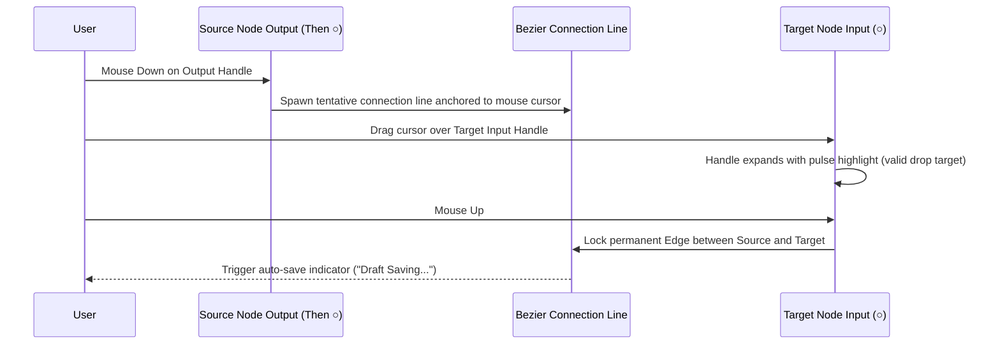

# Interaction Matrix & State Transition Specifications

**Target:** InstantDM (`app.instantdm.com`)
**Scope:** Interactive behaviors, event lifecycles, validations, and error handling across all major surfaces.

---

## 1. Global Interaction Matrix

| Surface / Component | Trigger / User Action | Immediate UI State Change | Validation / Side Effect | Error State & Fallback |
|---|---|---|---|---|
| **Top Shell** | Click Account Avatar | Open account switcher dropdown | Fetches connected Instagram accounts from `/insta-accounts` | Shows "Account disconnected" with reconnect button if token expired |
| **Top Shell** | Click Right Toggle `>>` | Collapses or expands right sidebar (`320px`) | Saves collapse state in `localStorage` | Default open on desktop (`>1280px`), hidden on mobile |
| **Auth Screen** | Click `Continue with Instagram` | Redirects to Meta OAuth endpoint | Validates `business_basic`, `business_manage_messages`, etc. | Shows reCAPTCHA or error banner if Instagram account is Personal |
| **Automations Hub** | Click Post Thumbnail (`/ig`) | Navigates to `/manage-post/:id` | Loads Instagram Media object and existing automation config | Shows empty state if media cannot be fetched |
| **Automations Hub** | Toggle Category Pills | Filters post grid (`Posts`, `Collabs`, `Stories`, `Live`) | Client-side filter or API query `?post_type=stories` | Displays "No posts found in this category" empty state |
| **Post Simulator** | Type new keyword chip | Adds chip to Trigger card; updates phone comment | Requires non-empty string; deduplicates keywords | Highlight duplicate input if keyword already exists |
| **Post Simulator** | Click `+ Reply Comment` | Adds public comment variation chip | Rotates replies in phone simulator preview | Limit max 10 reply variations to prevent spam |
| **Post Simulator** | Toggle `Follower Gate` | Expands follow-gate configuration card | Updates Phone DM view to show "Follow to Unlock" card | Warning if automation has no follow-up link |
| **Post Simulator** | Click `Publish` | Disables button, shows spinner, publishes config | Validates at least 1 keyword and 1 DM message | Toast error: "Please enter at least one message" |

---

## 2. Visual Flow Editor Interactions (`/flow-v2/editor`)

### 2.1. Canvas Manipulations
- **Pan Canvas:** Click and drag on empty canvas background (cursor changes to `grabbing`).
- **Zoom Canvas:** Mouse scroll wheel or bottom-left `+` / `-` buttons (bounded between `0.2x` and `2.0x`).
- **Fit View:** Clicking `[ ]` recalculates bounding box of all nodes and centers viewport with `50px` padding.

### 2.2. Node Selection & Positioning
- **Select Node:** Left-click on any node card.
  - Border glows `#6366f1` with `box-shadow: 0 0 0 3px rgba(99, 102, 241, 0.15)`.
  - Floating action menu appears above node: Duplicate (`⧉`) and Delete (`🗑`).
  - Contextual Configuration Drawer opens on right side (`360px` width).
- **Move Node:** Drag node header; connected cubic bezier edges dynamically recompute path in real-time (`requestAnimationFrame`).

### 2.3. Edge Connecting Lifecycle

- **Validation Rules:**
  - Cannot connect node to itself (circular self-loop prevented).
  - An output handle can connect to multiple target nodes (branching/fan-out supported).
  - Dropping connection line onto blank canvas opens "Choose Next Node" popover.

---

## 3. Contacts CRM Interactions (`/contacts-v2`)

1. **Platform Switcher:**
   - Clicking `Instagram` / `Facebook` changes table dataset and filters.
2. **Tag Filtering:**
   - Multi-select dropdown filters rows in real-time.
3. **Human Takeover Switch:**
   - Toggling the switch for a contact immediately updates state via API `PUT /api/contacts/:id/takeover`.
   - When **ON**: Any incoming message from this contact bypasses automated flow execution and alerts human agent in `/messenger`.
   - When **OFF**: Automated flows respond as usual.
4. **CSV Export:**
   - Clicking `⤓ Export` triggers asynchronous CSV generation containing `Username, Platform, Tags, Email, Phone, CreatedAt`.

---

## 4. Live Messenger Interactions (`/messenger`)

1. **Thread Selection:**
   - Clicking a user in thread list marks conversation as read, opens message history, and focuses reply textarea.
2. **Real-time Sending:**
   - Typing message and pressing `Enter` or clicking Send immediately renders optimistic outgoing message bubble, sends via Meta Graph API, and updates status tick.
3. **Takeover Sync:**
   - Manually sending a message from `/messenger` automatically activates **Human Takeover** for 24 hours to prevent bot and human colliding.
