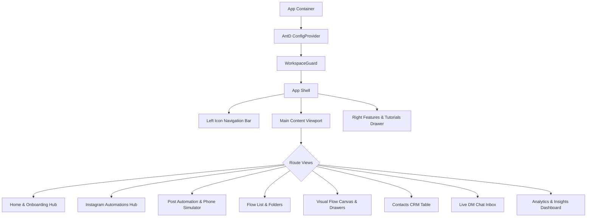

# UI Component Inventory & Architecture

**Target:** InstantDM (`app.instantdm.com`)
**Design Paradigm:** Modern SaaS with Clean Slate / Indigo Palette, Ant Design primitives, ReactFlow node graphs, and Custom Mobile Device Simulators.

---

## 1. High-Level Component Hierarchy

---

## 2. Core Layout & Shell Components

### 2.1. `LeftNav` (Global Icon Navigation)
- **Role:** Compact vertical primary navigation dock.
- **Dimensions:** Width `68px`, height `100vh`, fixed position, `border-right: 1px solid #eef1f6`.
- **States:**
  - Active item: Highlighted icon in `#6366f1` with subtle background tint `#eef2ff` or rounded indicator.
  - Hover item: Smooth transition, tooltip with route name on right.
  - User avatar at bottom with workspace status dot.

### 2.2. `TopHeader` (Account Bar)
- **Role:** Displays active connected social handle and right drawer controls.
- **Elements:**
  - Account Title (`@automation.normie` or current active IG handle).
  - Drawer collapse/expand toggle button (`>>`).

### 2.3. `RightSidebar` (Features & DM Insights)
- **Role:** Contextual helper and real-time AI insight sidebar.
- **Dimensions:** Width `320px`, collapsible.
- **Sections:**
  1. `More Features` (Quick links to Dashboard, Mobile App, Referral).
  2. `Tutorials` (Video cards with title, thumbnail, and duration badges).
  3. `DM Insights` (AI sentiment scanner tabs: `Priority` vs `Latest`, empty states with refresh button).

---

## 3. Specialized Custom Components

### 3.1. `InteractivePhoneSimulator` (Comment & DM Preview)
- **Used In:** `/manage-post/:id` (Comment-to-DM Setup).
- **Physical Structure:**
  - Realistic iPhone bezel (rounded corners, black frame, speaker/camera notch or dynamic island).
  - Status bar (`9:41`, Wi-Fi icon, cellular signal, battery indicator).
  - Top View Switcher (segmented toggle inside phone): `💬 Comment` vs `✉️ DMs`.
- **Interactive States:**
  - **Comment Mode:** Renders simulated Instagram Reel/Post media with comments tray sliding up from bottom. Shows commenter's comment bubble (`lead: Any comment will be automated`) followed by automated public reply (`your_account: Thanks for comment ❤️, check your dm.`).
  - **DM Mode:** Renders simulated Instagram Direct Message thread. Shows profile header, automated DM bubble with clickable buttons (e.g. `[ Open Link ]`), and follower-gate prompt if enabled.
- **Live Reactivity:** Edits made in the right-hand configuration panel instantly update text, buttons, and avatar in the phone simulator without page reload.

### 3.2. `ReelsGridCard` (Post Thumbnail Card)
- **Used In:** `/ig` (Instagram Automations Grid).
- **Aspect Ratio:** `9:16` vertical video thumbnail.
- **Elements:**
  - High-res cover image from Instagram Graph API media object.
  - Overlay Badge (top-left):
    - `⚡ Automated` (Green `#15803d` on `#dcfce7`).
    - `⊗ Not Automated` (Orange `#c2410c` on `#ffedd5`).
  - Hover effect: Scale up by 2%, dark overlay gradient, display quick action buttons (`Edit Automation`, `Analytics`).

### 3.3. `FlowCanvas` (Visual Node-Edge Graph Editor)
- **Used In:** `/flow-v2/editor`.
- **Canvas Engine:** Built on ReactFlow / SvelteFlow style graph architecture.
- **Canvas Features:**
  - Subtle dotted grid background (`#e2e8f0` dots on `#f8fafc`).
  - Viewport Controls (bottom-left): Zoom in (`+`), Zoom out (`-`), Fit to screen (`[ ]`).
  - Edge Routing: Smooth cubic bezier curves connecting output ports to input ports.

### 3.4. `FlowNode` Component Architecture
Every node card has:
1. **Header Pill Badge:** Icon + Category (e.g., `📷 Trigger`, `➤ Send Message`, `🤖 AI Agent`, `❓ Condition`).
2. **Body Container:** Descriptive text or summary of configured payload.
3. **Connection Ports (Handles):**
   - Input Port: Circular handle `○` on left boundary.
   - Output Port: Label + Circular handle (e.g. `Then ○` or `Next Step ○`) on right boundary.
4. **Selected State:** Glowing boundary border in `#6366f1` with floating action icons (Duplicate, Delete).

### 3.5. `NodeToolbeltDock` (Floating Bottom Bar)
- **Role:** Quick palette to add new nodes to the active canvas.
- **Placement:** Floating pill dock centered at `bottom: 24px`.
- **Buttons (from left to right):**
  - `↺ Undo` / `↻ Redo`
  - `➤ Send Message` (Pink)
  - `🤖 AI Agent` (Purple)
  - `❓ Condition` (Blue)
  - `✉ Collect Email` (Teal)
  - `👤 Set Custom Field` (Orange)
  - `🏷 Add/Remove Tag` (Yellow)
  - `⚡ Webhook / Action` (Magenta)
  - `📄 Digital File` (Gold)
  - `+ More Nodes`

### 3.6. `ConfigDrawer` (Right-Hand Configuration Flyouts)
- **Role:** Contextual parameter editor when a node is selected on the canvas.
- **Trigger Drawer:**
  - Toggles for `DM Reply`, `Story Reply`, and `Comment Reply`.
  - Condition filters (e.g. "Message contains any of these keywords").
- **Send Message Drawer:**
  - Sub-type selector: `Text` | `Button` | `Image` | `Audio` | `File`.
  - Rich textarea supporting variable interpolation (`{{username}}`, `{{email|default}}`).
  - Dynamic button builder: `+ Add Button` (Link URL, Trigger Next Flow, Call Phone).
  - Smart reply sequence: `+ Add Delay` (e.g. wait 5 seconds, typing indicator animation).

### 3.7. `ContactsTable` & `FilterBar`
- **Used In:** `/contacts-v2`.
- **Components:**
  - Platform Switcher (Instagram vs Facebook).
  - Search Input with debounce.
  - Tag Select (multi-select pill dropdown).
  - Flow Filter dropdown.
  - Table: Ant Design Table with custom column renderers for avatars, colored tag pills, human takeover toggle switch, and date formatters.
  - Export CSV action trigger.

### 3.8. `MessengerInbox` (Two-Pane Chat Application)
- **Used In:** `/messenger`.
- **Components:**
  - Folder & Tag Selector (`Messages ▾`, `+ New Folder`).
  - Thread List Item: Avatar, Instagram handle, last message snippet, timestamp, unread badge.
  - Message Feed: Alternating chat bubbles (grey for incoming user, purple for bot/agent outgoing).
  - Compose Bar: Emoji picker, quick reply macro selector, attachment icon, send button.
