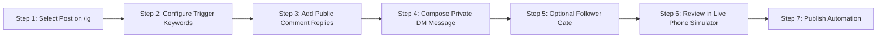
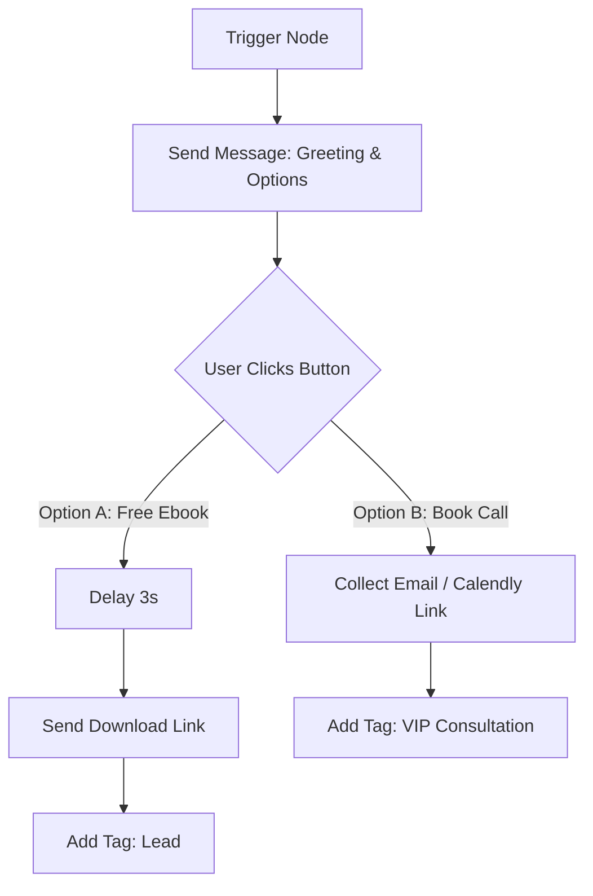

# Workflow Specifications

**Target:** InstantDM (`app.instantdm.com`)
**Scope:** Step-by-step procedural specifications for core product workflows verified in production.

---

## Workflow 1: Single Post Comment-to-DM Setup

### Purpose
Enable a creator to select a specific Instagram Reel or Post and automatically send a Direct Message with a link or resource whenever an audience member comments a designated keyword.

### Step-by-Step Flow

1. **Step 1: Select Post**
   - User navigates to `/ig` and selects a Reel or Post card in the grid.
   - Router transitions to `/manage-post/:id`.
   - App loads post media and checks if an existing automation record exists.

2. **Step 2: Configure Trigger Keywords**
   - User chooses between:
     - `Specific Comments`: Adds keywords (e.g. `link`, `guide`, `ebook`, `pricing`). Matches are case-insensitive.
     - `All comments 👑`: Every comment on the post triggers the automation (Pro plan feature).

3. **Step 3: Configure Public Comment Replies**
   - User enables `Reply with comment!` toggle.
   - User adds 2 to 5 variation phrases (e.g., `Thanks for comment ❤️, check your dm.`, `Sent to your DM! 🚀`, `Check inbox 📩`).
   - The engine randomly rotates between these variations to prevent Meta comment-spam algorithmic flags.
   - Optional: Toggle `AI Comment Reply` to generate contextual, polite replies dynamically using LLM.

4. **Step 4: Compose Private Direct Message**
   - User switches Phone simulator view to `DMs` tab.
   - User types the DM payload containing text and a CTA button with URL.
   - Supports tags like `{{username}}` and link tracking toggles.

5. **Step 5: Optional Follower Gate**
   - User toggles `Ask audience to follow you before sending link!`.
   - If user doesn't follow the account, they receive an intermediary DM:
     - Text: *"Looks like you haven't followed me yet! Follow to unlock exclusive content!"*
     - Buttons: `[ Open Profile ]`, `[ Started following you! 👍 ]`.
   - When the user clicks `Started following you!`, the webhook checks friendship status via Graph API and releases the locked link.

6. **Step 6: Review & Publish**
   - User tests the flow inside the interactive iPhone simulator.
   - User clicks `Publish` on top right. Status changes from `Not Automated` to `⚡ Automated`.

---

## Workflow 2: Visual Multi-Step DM Flow Builder

### Purpose
Build branching conversation trees, quiz funnels, lead collection sequences, and automated customer journeys.

### Step-by-Step Flow

1. **Step 1: Create Flow**
   - From `/flow-v2`, user clicks `+ New Automation`.
   - A modal prompts: *"Name your automation (e.g. Hair products comment flow)"*.
   - A blank canvas renders with a default `Trigger` node and `Send Message` node linked by a curved edge.

2. **Step 2: Define Trigger**
   - User clicks `+ Set up Trigger` on the Trigger card.
   - Right drawer opens allowing multi-trigger selection:
     - `DM Reply`: Triggered when audience sends direct message containing keywords.
     - `Story Reply`: Triggered when audience replies to active Stories.
     - `Comment Reply`: Triggered across all posts, Reels, or Live comments.

3. **Step 3: Build Message Sequence**
   - User clicks `Send Message` card to edit text and buttons.
   - User adds interactive buttons: `[ Learn More ]`, `[ Get Promo Code ]`.
   - Each button creates a new output handle port on the node.

4. **Step 4: Branching Logic & Delays**
   - From button output handle, user drags an edge to a new `Delay` node (e.g. wait 5 seconds with simulated typing indicator).
   - User drags edge to another `Send Message` node or `Condition` node.

5. **Step 5: Tagging & Lead Capture**
   - User connects an `Add Tag` node (e.g. `Tag: Ebook-Downloaded`).
   - User connects a `Collect Email` node; when audience replies with an email address, system validates regex format and saves to Contact profile.

6. **Step 6: Test & Set Live**
   - User clicks `📱 Preview` to test the sequence in modal simulator.
   - User clicks `✓ Set Live` on top toolbar.

---

## Workflow 3: Story Reply & Mention Automations

1. Creator posts an Instagram Story: *"Reply 'PROMO' to get 50% off today!"*
2. Audience types `PROMO` in Story reply field.
3. Meta Webhook triggers `messaging_postbacks` / `messages` event with `message.reply_to.story`.
4. InstantDM detects matching Story Reply trigger and fires configured DM sequence within 1–2 seconds.

---

## Workflow 4: Contact CRM & Human Takeover

1. When a contact interacts with any automation, a Contact record is automatically created or updated in `/contacts-v2`.
2. Captured fields (email, phone, tags, total messages) are indexed.
3. If an audience member sends a support inquiry requiring human attention:
   - Creator clicks into `/messenger` or toggles `Human takeover` in `/contacts-v2`.
   - Automation engine halts all automated follow-ups for this user.
   - Creator conducts live one-on-one conversation without bot interference.
